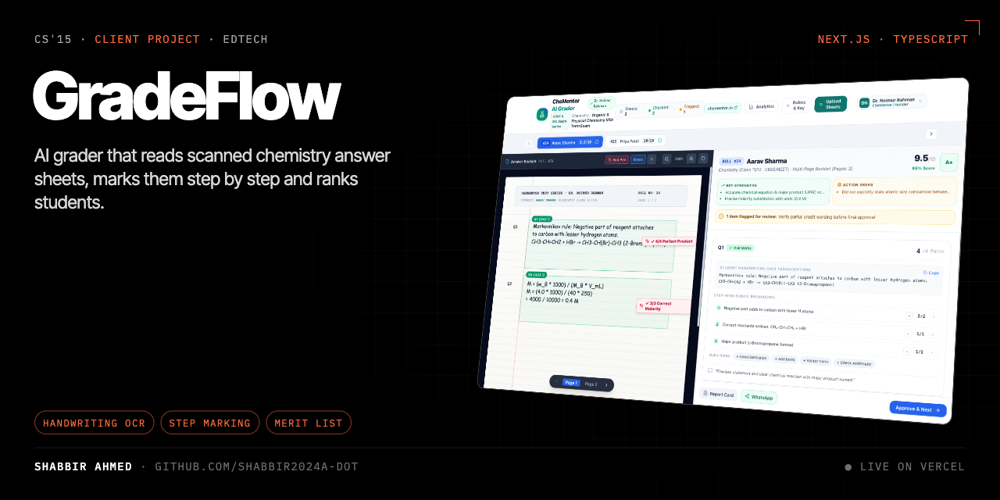

# GradeFlow — AI answer-sheet grader

An AI grading platform built for a chemistry coaching institute.

**Live:** https://gradeflow-rouge.vercel.app

Teachers upload a batch of scanned answer booklets (up to 100). GradeFlow:

- groups the pages of each student's booklet and flags missing or duplicate pages
- reads handwritten chemistry, including equations, reaction arrows and ionic notation
- marks each answer step by step against the marking scheme, and accepts alternative valid names
- lets the teacher review and adjust marks before publishing
- produces a ranked merit list

**Tech:** Next.js · TypeScript · Tailwind CSS · Vitest

> This is a client project, so the source code is private. This repository only describes it.
